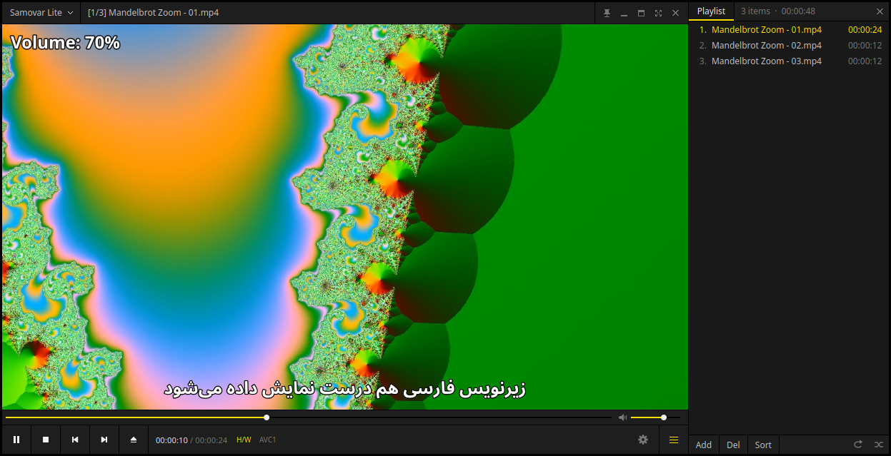
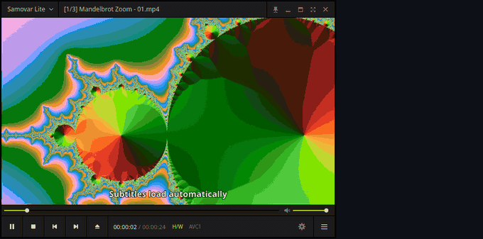

<p align="center">
  
</p>
<h1 align="center">Samovar Lite</h1>
<p align="center">
  A PotPlayer-style media player for Linux.<br>
  Drop a video on it, load a subtitle, forget about codecs.
</p>
<p align="center">
  <a href="https://github.com/AliMilani/samovar-lite/actions/workflows/ci.yml"></a>
  <a href="https://github.com/AliMilani/samovar-lite/releases/latest"></a>
  <a href="LICENSE"></a>
  
  
</p>



Samovar Lite gives Linux the player many people miss after leaving Windows: the compact dark window, the
mouse habits (click to pause, double-click for full screen, wheel for volume, drag to move), the
right-click menu with everything in it, and the keyboard shortcuts your fingers already know.
Playback is done by [libmpv](https://mpv.io), so it plays whatever mpv plays, with hardware decoding
and proper subtitle rendering. The window and controls are Qt 6.



## Features

- **Drop to play.** Drop files, folders or URLs on the window. Drop a subtitle on a playing video to
  load it. Hold Ctrl, or drop on the playlist, to queue instead.
- **Subtitles that just work.** A subtitle next to the video loads by itself. UTF-8 is read as UTF-8,
  everything else as Windows-1256 (Arabic/Persian) by default, switchable from the menu. Sync, size and
  position have shortcuts; a second subtitle can be shown at the same time.
- **Familiar controls.** About a hundred PotPlayer-compatible shortcuts, which keep working while a
  non-Latin keyboard layout is active.
- **Playlist** that queues the other episodes of a show automatically, with repeat and shuffle.
- **Remembers where you stopped** in every file.
- **Control panel** with a 10-band equalizer, picture controls, subtitle and speed sliders.
- **Full screen done right**: controls, title bar and playlist appear at the screen edges; subtitles
  move out of the way of the controls.
- Frame stepping, A-B repeat, speed control, chapters, zoom and pan, rotation, aspect ratios,
  screenshots to file or clipboard, audio and subtitle stream selection, audio output selection.
- Native **Wayland** and **X11**. A second launch hands its files to the window that is already open.

## Install

On Ubuntu or Debian:

```sh
git clone https://github.com/AliMilani/samovar-lite.git
cd samovar-lite
./install.sh
```

That builds a private Python environment in the folder, adds a `samovar-lite` command and a menu entry with
"Open With" support. Nothing is installed system-wide, except that the script asks for `sudo` once if
the libmpv library is missing. `./install.sh --remove` undoes it.

Other distributions: install Python 3.10+, libmpv (`mpv-libs`, `libmpv`, `mpv` depending on the
distribution) and run the same script; or install the wheel from the
[latest release](https://github.com/AliMilani/samovar-lite/releases/latest) with `pipx install <wheel>`.

## Use

```sh
samovar-lite                      # empty window: drop something on it
samovar-lite movie.mkv            # play a file
samovar-lite movie.mkv subs.srt   # ... with a specific subtitle
samovar-lite ~/Videos/Show/       # queue a folder
samovar-lite https://...          # play a URL (sites like YouTube need yt-dlp)
```

Options: `-f` full screen, `--x11` run through XWayland (enables always-on-top), `--new` open a second
window, `--verbose` print engine messages.

**Mouse on the video:** click = play/pause, double-click = full screen, drag = move the window,
wheel = volume, middle click = full screen, right click = menu, back/forward buttons = previous/next
file. In full screen, move to the bottom edge for the controls, the top edge for the title bar and the
right edge for the playlist.

<details>
<summary><b>Keyboard shortcuts</b></summary>

| Keys | Action |
|------|--------|
| Space | Play / pause |
| Enter | Full screen (Esc leaves) |
| Left / Right | Seek 5 s (Ctrl: 30 s, Shift: 1 min, Ctrl+Alt: 5 min) |
| Up / Down | Volume; M mutes |
| PgUp / PgDn | Previous / next file (Shift: chapter) |
| Backspace | Play from the beginning |
| F / D | Next / previous frame |
| C / X / Z | Faster / slower / normal speed |
| G | Go to time |
| [ &nbsp; ] &nbsp; \ | A-B repeat: start, end, clear |
| , &nbsp; . &nbsp; / | Subtitle sync -0.5 s / +0.5 s / reset |
| Shift+, &nbsp; Shift+. &nbsp; Shift+/ | Audio sync -0.05 s / +0.05 s / reset |
| Alt+O | Load subtitle |
| Alt+H / Alt+L / L | Hide subtitles / next subtitle / subtitle menu |
| A / Shift+A | Audio stream menu / next audio stream |
| Alt+PgUp, Alt+PgDn, Alt+Up, Alt+Down | Subtitle size and position |
| Ctrl+O, F3 / F2 / Ctrl+U | Open files / folder / URL |
| F4 | Close playback |
| F5 / F6 / F7 | Preferences / playlist / control panel |
| Tab / Ctrl+F1 | Playback info overlay / full info window |
| Ctrl+E, Ctrl+C | Save / copy the current frame (Ctrl+Alt: with subtitles) |
| 1 2 3 4 | Window size 50 / 100 / 150 / 200 % |
| W E, R T, Y U, I O, Q | Brightness, contrast, saturation, hue, reset |
| Numpad 9 1 / 4 6 8 2 / 5 | Zoom / pan / reset |
| Alt+K, Ctrl+Z, Ctrl+V | Rotate, flip horizontally, flip vertically |
| Ctrl+T | Always on top |
| Ctrl+Q, Alt+F4 | Exit |

</details>

Settings are stored in `~/.config/samovar-lite/settings.json`.

## Limits

- **Always on top** does not exist on native Wayland. Start with `--x11`, or switch it on under
  Preferences > General.
- Window position is not restored on Wayland; the compositor places windows.
- Not implemented: skins, filter management, TV and capture devices, 3D, bookmarks, and media-key
  control while the window is not focused (MPRIS).
- Tested on Ubuntu with GNOME on Wayland and under X11. Other desktops should work but are less
  travelled; please [report](https://github.com/AliMilani/samovar-lite/issues) what you find.

## Troubleshooting

- **Hardware decoding** uses copy-back decoders, which work on every GPU and session type. With
  Intel or AMD graphics VA-API is tried first. If the badge in the control bar says `S/W`, or a laptop
  wakes its NVIDIA GPU for video, install the VA-API driver (`sudo apt install intel-media-va-driver`
  on Intel).
- **Black horizontal stripes on Intel graphics.** Mesa's Intel driver can corrupt the lookup textures
  of mpv's high-quality scalers when the video size changes. Samovar Lite avoids those scalers on Intel
  renderers; `SAMOVAR_LITE_NO_GPU_WORKAROUNDS=1` turns that off if you want mpv's defaults back.
- **libmpv** is taken from the system (`sudo apt install libmpv2`). `SAMOVAR_LITE_LIBMPV=/path/to/libmpv.so.2`
  selects a specific build.
- `samovar-lite --verbose` prints engine messages; Ctrl+F1 shows the most recent ones.

## Development

```sh
./install.sh --no-desktop                    # environment only
.venv/bin/python -m pip install pytest ruff
.venv/bin/python -m pytest                   # unit tests
.venv/bin/python tests/smoke.py              # end-to-end test, drives the real window
ruff check . && ruff format --check .
```

The code is small: `samovar_lite/app.py` is the window and its actions, `engine.py` wraps libmpv and
renders into an OpenGL widget, `widgets.py` and `skin.py` draw the controls, `menus.py`, `playlist.py`
and `dialogs.py` are what their names say. See [CONTRIBUTING.md](CONTRIBUTING.md).

## License and credits

Samovar Lite is free software under the [GNU General Public License, version 3 or later](LICENSE).

It stands on [mpv](https://mpv.io) and [FFmpeg](https://ffmpeg.org) for playback,
[Qt for Python](https://doc.qt.io/qtforpython-6/) for the interface and
[python-mpv](https://github.com/jaseg/python-mpv) to connect the two.

Samovar Lite is an independent project. It is not affiliated with or endorsed by Kakao Corp.; PotPlayer is
their product and trademark, mentioned here only to describe what Samovar Lite feels like to use. All
controls are drawn by Samovar Lite's own code; no third-party artwork is included.
